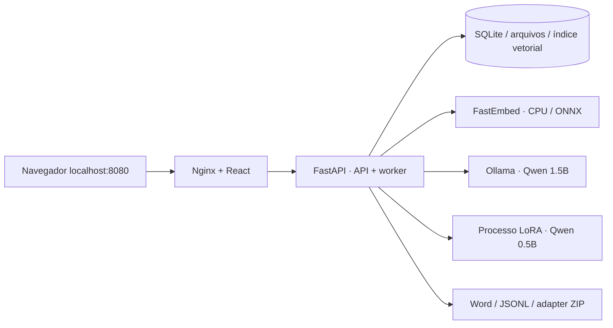

# Arquitetura implementada da POC

São três containers rootless: `simplfaq-web`, `simplfaq-api` e `simplfaq-ollama`, numa rede Podman privada. Apenas Nginx publica uma porta no loopback. O worker e o treinamento pertencem ao mesmo backend; não há microserviço ou framework de agentes adicional.

## Estado e concorrência

`draft → queued → processing → review → approved | rejected`. Falhas vão para `failed`, com nova tentativa explícita. Novos uploads invalidam o resultado anterior e incrementam a versão. Edições e decisões usam comparação de versão dentro de uma transação `BEGIN IMMEDIATE`. Eventos aprovados são imutáveis. Auditoria, decisão e histórico são gravados na mesma transação.

Uma única thread lê a fila persistida. A API permanece responsiva durante inferência. Na inicialização, jobs anteriormente em execução passam a falha recuperável com registro de interrupção. Não execute múltiplos workers Uvicorn, pois a POC não utiliza um coordenador distribuído.

## Ingestão e recuperação

Extração valida extensão, conteúdo, limites e expansão de ZIP para Office. Normalização Unicode, chunking com sobreposição e localização de página/slide/planilha. Todos os arquivos atuais são indexados; versões anteriores preservam os originais, mas não contribuem para novos contextos.

Coleções `event_current`, `faq_history_approved`, `language_guidelines`. A busca factual filtra o evento; histórico exige aprovação e mesma empresa não vazia. Embeddings ONNX multilíngues são persistidos como vetores no SQLite. A busca é exata por cosseno, seguida de reranking híbrido. Isso simplifica a operação para uma POC; grandes bases precisarão de um índice ANN local. A versão do modelo fica em cada chunk e divergências exigem reindexação explícita.

O fluxo padrão usa a definição única `faq_template.json`: avaliação das 12 seções com resumos de até 30 chunks, recuperação factual por seção, até dois chunks normativos por sistema, uma referência histórica e uma linguística. Geração PT e tradução EN são chamadas separadas. IDs e evidências acompanham cada afirmação. Limites, geração inconclusiva e fontes não cobertas aparecem como lacunas. O conteúdo é delimitado como dados não confiáveis no prompt. Citações e números são verificados independentemente do modelo. O fluxo legado conserva os limites anteriores de três domínios, sem reescrever FAQs existentes.

Para Ollama, a gramática restringe IDs aos chunks fornecidos e a geração a três perguntas por seção. O limite configurável de caracteres do prompt falha explicitamente, sem truncamento pelo aplicativo. Ele não substitui a tokenização do modelo. A gramática simplificada evita a expansão excessiva de limites de strings no llama.cpp; o resultado continua validado pelo schema Pydantic completo.

`normative_current` é uma coleção adicional, em tabelas próprias, com filtros obrigatórios de sistema, status ativo, vigência e versão opcional. PDFs e snapshots da página oficial ficam no volume. A migração 002 é aditiva e idempotente, inclusive após rollback de uma imagem antiga que reajusta o `user_version`. Tarefas de atualização de manuais compartilham a fila com geração e treinamento. A capa e a página oficial devem concordar sobre título e versão; atualizações iguais verificam o hash sem reindexar. Vigências futuras ficam pendentes até nova verificação em data válida no horário brasileiro. Uma desativação explícita não é revertida por essa verificação.

## Revisão e aprendizado

O modelo produz PT, uma chamada traduz para EN e outra verifica groundedness, equivalência e conflitos. Essa validação é assistiva e pode errar. Todo item e toda seção permanecem pendentes até revisão explícita. Para aprovar, todas as perguntas precisam ter fontes atuais válidas, confirmação bilíngue e nota de revisão; todas as 12 seções também exigem avaliação humana registrada. Normativos desativados bloqueiam a aprovação. Uma aprovação incorpora a FAQ ao histórico na mesma transação. Na compatibilidade legada, conserva-se o contrato anterior de revisão de itens.

Justificativas semânticas idênticas entre itens tornam os respectivos resultados inconclusivos. O revisor pode corrigir também o domínio. A métrica de edição humana conta alterações efetivas no conteúdo ou nas citações, separadamente da confirmação de revisão. Nenhuma avaliação do modelo substitui a aprovação humana.

Fine-tuning usa dados aprovados, inclui contexto de fontes nas entradas e mascara a loss dos tokens de entrada. Treino em CPU com LoRA rank 4, gradiente com checkpoint e limite de sequência. O modelo de geração é descarregado antes do treino. O ZIP resultante guarda métricas e proveniência, mas exige avaliação antes de servir inferências com o adapter.

## Limites conhecidos

- POC de usuário único, acesso local; sem isolamento por cliente/equipe.
- PDFs digitalizados não têm OCR integrado.
- A validação numérica é conservadora e não interpreta todos os formatos de datas, unidades ou números por extenso.
- Prompt injection não é eliminada por prompt; citações, validação determinística e aprovação humana reduzem o impacto, sem promessa de blindagem absoluta.
- Quantidade de registros retornada na lista de eventos limitada a 500; auditoria tem paginação.
- Auditoria protegida contra alterações pelo aplicativo, não contra acesso administrativo ao volume.
- Modelo de 1.5B em CPU prioriza viabilidade; qualidade e cobertura precisam de revisão. Fine-tuning de oito passos é uma demonstração técnica.
- Adapters LoRA não são promovidos automaticamente nem compatíveis entre tamanhos diferentes de modelo.
- O acesso à internet é necessário para o primeiro download dos pesos. Não há envio de documentos a serviços externos na configuração local.

As integrações corporativas do handoff foram retiradas do escopo por solicitação expressa. O código opcional Entra/B3 não foi validado contra serviços corporativos reais.
